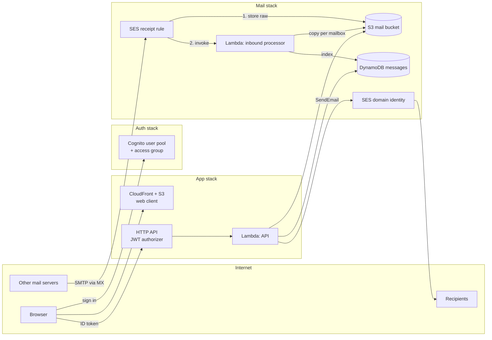

# Architecture

## Receiving

The domain's MX points to SES. The receipt rule accepts mail for any address on the domain, runs
the spam and virus scan, then:

1. **S3 action** stores the raw message at `inbound/<SES message id>` (kept `rawInboundRetentionDays`).
2. **Lambda action** (asynchronous) runs the inbound processor, which copies the message to
   `mailboxes/<address>/<id>.eml` for each recipient on the domain and writes one DynamoDB item per
   copy. Failures are retried twice, then sent to the `InboundDeadLetterQueueUrl` queue.

Virus `FAIL` is dropped; spam or DMARC `FAIL` goes to Junk. Mail to addresses with no user is still
stored and becomes visible to a user later created with that `custom:primary_email`. Nothing polls:
SES pushes events, and the web client refreshes on navigation or on *Refresh*.

## Sending

Synchronous, no queue. The API Lambda builds the MIME message, calls SES `SendEmail` (raw; the SDK
retries throttling and transient errors), and only after SES accepts it stores the copy in S3 and the
Sent item in DynamoDB. SES rejections return `422`, throttling `429`. After acceptance SES retries
delivery; bounces and complaints reach the sender's inbox through SES feedback forwarding and are
otherwise unhandled (see TODO).

SES signs with DKIM and uses `mail.<domain>` as MAIL FROM, so SPF and DKIM both align with `From:`.

## Access

The HTTP API validates Cognito ID tokens. The Lambda also requires membership of the access group
and serves only the caller's mailboxes: their own (`custom:primary_email`, which the app client
cannot write) and every collective address whose Cognito group `mailbox:<address>` they belong to.
Groups come from the ID token, so membership changes apply at the next token refresh.

Collective mail is stored once under its address, like any mailbox, so members share its folders and
read state. Sending from a collective address uses the member's name with that address, and the copy
goes to that mailbox's Sent folder.

## Stacks

| Stack           | Contents                                                                                       | On destroy            |
| --------------- | ---------------------------------------------------------------------------------------------- | --------------------- |
| `<prefix>-Mail` | SES identity, receipt rule set, mail bucket, DynamoDB table, inbound Lambda + DLQ, DNS outputs | Bucket, table retained |
| `<prefix>-Auth` | Cognito user pool, access group, hosted sign-in domain                                         | User pool retained    |
| `<prefix>-App`  | CloudFront + site bucket, Cognito app client, HTTP API, API Lambda                             | Removed               |

## API

All routes require `Authorization: Bearer <Cognito ID token>`. Message routes take `?mailbox=<address>`
(default: the caller's first mailbox) and answer `403 mailbox_forbidden` for mailboxes the caller
cannot use.

| Route                   | Description                                                                                     |
| ----------------------- | ----------------------------------------------------------------------------------------------- |
| `GET /me`               | `{ mailbox, mailboxes, name, domain }`; `mailboxes` lists own and collective addresses           |
| `GET /messages`         | `?folder=INBOX\|SENT\|JUNK\|TRASH&limit=1..100&cursor=…` → `{ messages, cursor? }`, newest first |
| `GET /messages/{id}`    | Message with plain-text body (parsed from S3 on each read)                                      |
| `POST /messages`        | `{ to, cc?, bcc?, subject, text, inReplyTo? }`; ≤ 50 recipients; `inReplyTo` is a message id     |
| `PATCH /messages/{id}`  | `{ read?, folder? }`                                                                             |
| `DELETE /messages/{id}` | Permanent delete; message must be in `TRASH`                                                    |

## Data model

| Key                | Attribute   | Format                                                                                  |
| ------------------ | ----------- | --------------------------------------------------------------------------------------- |
| Table partition    | `mailbox`   | `alice@example.com`                                                                     |
| Table sort         | `id`        | `<13-digit epoch ms>-<SES message id \| UUID>` (chronological; idempotent inbound retries) |
| `byFolder` partition | `folderKey` | `<mailbox>#<FOLDER>`                                                                  |
| `byFolder` sort    | `id`        | as above                                                                                |

Items hold the summary (from, to, cc, bcc, subject, snippet, date, read, attachments, verdicts) and
`s3Key`; the body is read from `mailboxes/<mailbox>/<id>.eml`. There is no TTL: mail is only deleted
by the user.
